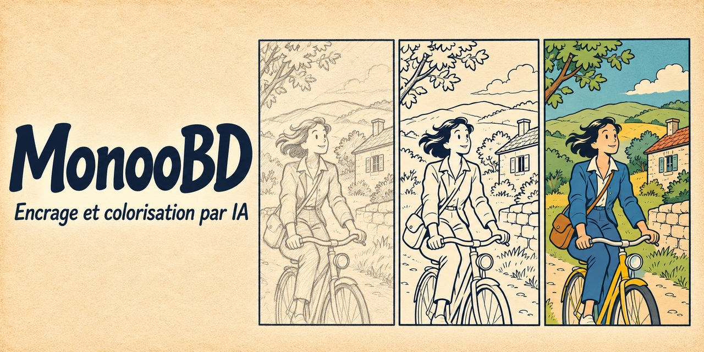

<h1>
  
  MonooBD
</h1>



# MonooBD

Personal tool for finishing Belgian-style comic pages.  
Workflow: paper sketch → scan → upload → the AI finishes the job → side-by-side preview.

**Two actions:**
- **Inking** (`encrage`) — cleans up the line art in black and white, *ligne claire* style (Hergé/Tintin)
- **Colouring** (`colorisation`) — applies colours to an existing inked page

**Stack:** HuggingFace Diffusers (SD 1.5 + ControlNet) · FastAPI · Node.js/Express · Google SSO · Coolify/Traefik · CPU only  
**URL:** `https://monoobd.monolithoid.com`

---

## Architecture

```
browser → Traefik → monoobd-webapp (Node.js/Express) → bd-inference (FastAPI/Diffusers)
                                                               ↓
                                               /opt/ia/bd/models/hf-cache/  (SD 1.5 + ControlNet, ~5 GB)
                                               /opt/ia/bd/outputs/           (history)
```

| Service | Image | Internal port |
|---|---|---|
| `bd-inference` | `monolithoid/bd-inference` | `127.0.0.1:8000` |
| `monoobd-webapp` | `monolithoid/bd-webapp` | `127.0.0.1:8080` → `monoobd.DOMAIN` |

### Inference API

| Endpoint | Description |
|---|---|
| `GET /health` | `{"ready": true}` — checks that the service is running |
| `POST /generate` | img2img + ControlNet generation |

`/generate` payload:
```json
{
  "image": "<base64 PNG>",
  "prompt": "...",
  "negative_prompt": "...",
  "mode": "encrage",
  "steps": 20,
  "cfg_scale": 7.0,
  "denoising_strength": 0.7
}
```

---

## Step-by-step deployment

### 1. Google OAuth

1. [Google Cloud Console](https://console.cloud.google.com/) → APIs & Services → Credentials
2. **Create Credentials** → OAuth 2.0 Client ID → Web application
3. Authorized redirect URIs: `https://monoobd.monolithoid.com/auth`
4. Copy the **Client ID** and **Client Secret**

### 2. Docker Hub

Secrets to set in the repo's **Settings → Secrets → Actions**:

| Secret | Value |
|---|---|
| `DOCKERHUB_USERNAME` | `monolithoid` |
| `DOCKERHUB_TOKEN` | Docker Hub → Account Settings → Security → New Access Token |

The first push to `main` triggers the CI build.  
`bd-webapp`: ~2 min (Node alpine). `bd-inference`: ~10-15 min (Python + PyTorch CPU).

### 3. Preparing the VPS

```bash
ssh root@VPS
wget -O setup-vps.sh https://raw.githubusercontent.com/monolithoid/ia-bd/main/setup-vps.sh
bash setup-vps.sh
```

Creates `/opt/ia/bd/{models,outputs,sessions}` and configures UFW.

### 4. Coolify deployment

1. **New Resource** → Docker Compose Raw → paste `docker-compose.yml`  
   *(or point to this GitHub repository)*
2. Set the **Environment Variables**:

| Variable | Value | Description |
|---|---|---|
| `DOMAIN` | `monolithoid.com` | Main domain |
| `DOCKERHUB_USERNAME` | `monolithoid` | Docker Hub username |
| `OAUTH_CLIENT_ID` | `123…apps.googleusercontent.com` | Google OAuth |
| `OAUTH_CLIENT_SECRET` | `GOCSPX-…` | Google OAuth |
| `SESSION_SECRET` | *(openssl rand -hex 32)* | Session encryption key |
| `ALLOWED_EMAIL` | `you@gmail.com` | The only allowed Gmail address (required: without it, every login is refused) |
| `PRELOAD_MODES` | `encrage,colorisation` | Pipelines to load at startup (optional) |
| `DEFAULT_BACKEND` | `local` | Default AI engine: `local`, `openai` or `novelai` (optional) |
| `OPENAI_API_KEY` | `sk-...` | Enables the ChatGPT / OpenAI Images engine (optional) |
| `OPENAI_IMAGE_MODEL` | `gpt-image-1` | OpenAI model to use (optional) |
| `OPENAI_IMAGE_QUALITY` | `medium` | `low`, `medium` or `high` (optional, affects cost) |
| `NOVELAI_API_KEY` | `pst-...` | NovelAI Persistent API Token, enables the NovelAI engine (optional) |
| `NOVELAI_MODEL` | `nai-diffusion-4-5-full` | NovelAI model to use (optional) |
| `NOVELAI_STRENGTH` | `0.6` | NovelAI img2img strength, 0 to 1: higher = more detail added, less faithful to the sketch (optional) |
| `LOCAL_ENABLED` | `true` | `false` to hide the local engine (optional) |

3. Click **Deploy**

### 5. First start

On first start, the `bd-inference` service downloads ~5 GB of models from HuggingFace:

```bash
docker logs -f bd-inference
# Wait for: Pipeline encrage ready.
#           Application startup complete.
```

The models are then cached in `/opt/ia/bd/models/hf-cache/` — later restarts are immediate.

---

## Usage

1. Open `https://monoobd.monolithoid.com`
2. Sign in with Google
3. Drag and drop the sketch scan
4. Click **Encrer** (ink) or **Coloriser** (colour)
5. Wait 10-30 min (CPU, no GPU)
6. Compare the original and the result side by side

---

## Generation settings

| Action | ControlNet model | Denoising | Main prompt |
|---|---|---|---|
| Inking | Scribble (`control_v11p_sd15_scribble`) | 0.70 | ligne claire, Hergé, B&W, crisp lines |
| Colouring | Lineart (`control_v11p_sd15_lineart`) | 0.50 | Tintin style, flat colors, vibrant |

Base: `runwayml/stable-diffusion-v1-5`

---

## Performance (CPU, 22 GB RAM)

| Image | Steps | Estimated time |
|---|---|---|
| 512 × 512 | 20 | ~10-15 min |
| 768 × 768 | 20 | ~25-40 min |

---

## Updating

```bash
# Trigger a new build
git commit --allow-empty -m "chore: rebuild" && git push
# Redeploy from Coolify: Redeploy button
```

---

## Troubleshooting

**`bd-inference` does not respond**  
→ `docker logs bd-inference` — check the HuggingFace model download

**`/health` returns 500**  
→ The models may be corrupted: delete `/opt/ia/bd/models/hf-cache/` and restart

**OAuth error redirect_uri_mismatch**  
→ The URI `https://monoobd.monolithoid.com/auth` must be configured exactly in Google Cloud Console

**Session lost after redeploying**  
→ Always use the same `SESSION_SECRET` value across deployments

**Generation is very slow**  
→ Expected on CPU — prefer `PRELOAD_MODES=encrage,colorisation` to avoid reloading between calls
