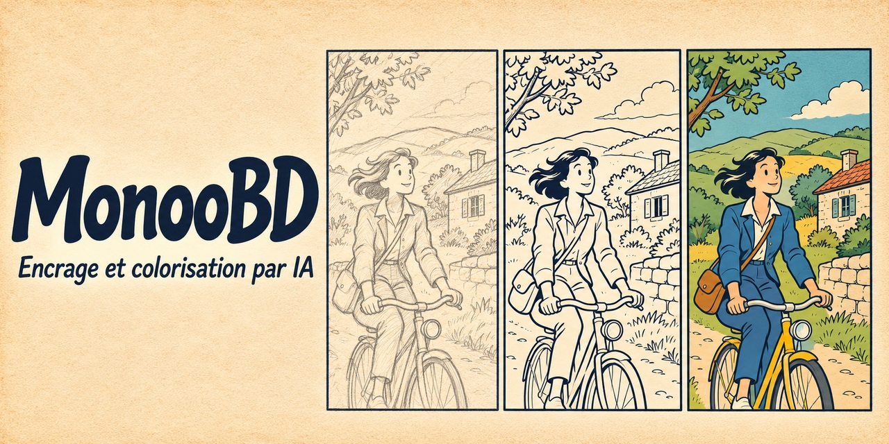

<h1>
  
  MonooBD
</h1>



# MonooBD

Outil personnel pour finir des planches de bande dessinée belge.  
Workflow : croquis papier → scan → upload → IA finit le travail → prévisualisation côte à côte.

**Deux actions :**
- **Encrage** — nettoie le trait en noir et blanc, style ligne claire (Hergé/Tintin)
- **Colorisation** — applique des couleurs à un encrage existant

**Stack :** HuggingFace Diffusers (SD 1.5 + ControlNet) · FastAPI · Node.js/Express · Google SSO · Coolify/Traefik · CPU uniquement  
**URL :** `https://monoobd.monolithoid.com`

---

## Architecture

```
browser → Traefik → monoobd-webapp (Node.js/Express) → bd-inference (FastAPI/Diffusers)
                                                               ↓
                                               /opt/ia/bd/models/hf-cache/  (SD 1.5 + ControlNet, ~5 Go)
                                               /opt/ia/bd/outputs/           (historique)
```

| Service | Image | Port interne |
|---|---|---|
| `bd-inference` | `monolithoid/bd-inference` | `127.0.0.1:8000` |
| `monoobd-webapp` | `monolithoid/bd-webapp` | `127.0.0.1:8080` → `monoobd.DOMAIN` |

### API inference

| Endpoint | Description |
|---|---|
| `GET /health` | `{"ready": true}` — vérifie que le service tourne |
| `POST /generate` | Génération img2img + ControlNet |

Payload `/generate` :
```json
{
  "image": "<base64 PNG>",
  "prompt": "...",
  "negative_prompt": "...",
  "mode": "encrage",
  "steps": 20,
  "cfg_scale": 7.0,
  "denoising_strength": 0.7
}
```

---

## Déploiement pas à pas

### 1. Google OAuth

1. [Google Cloud Console](https://console.cloud.google.com/) → APIs & Services → Credentials
2. **Create Credentials** → OAuth 2.0 Client ID → Web application
3. Authorized redirect URIs : `https://monoobd.monolithoid.com/auth`
4. Copier **Client ID** et **Client Secret**

### 2. Docker Hub

Secrets à configurer dans **Settings → Secrets → Actions** du repo :

| Secret | Valeur |
|---|---|
| `DOCKERHUB_USERNAME` | `monolithoid` |
| `DOCKERHUB_TOKEN` | Docker Hub → Account Settings → Security → New Access Token |

Le premier push sur `main` déclenche le build CI.  
`bd-webapp` : ~2 min (Node alpine). `bd-inference` : ~10-15 min (Python + PyTorch CPU).

### 3. Préparation du VPS

```bash
ssh root@VPS
wget -O setup-vps.sh https://raw.githubusercontent.com/monolithoid/ia-bd/main/setup-vps.sh
bash setup-vps.sh
```

Crée `/opt/ia/bd/{models,outputs,sessions}` et configure UFW.

### 4. Déploiement Coolify

1. **New Resource** → Docker Compose Raw → coller `docker-compose.yml`  
   *(ou pointer vers ce dépôt GitHub)*
2. Configurer les **Environment Variables** :

| Variable | Valeur | Description |
|---|---|---|
| `DOMAIN` | `monolithoid.com` | Domaine principal |
| `DOCKERHUB_USERNAME` | `monolithoid` | Username Docker Hub |
| `OAUTH_CLIENT_ID` | `123…apps.googleusercontent.com` | Google OAuth |
| `OAUTH_CLIENT_SECRET` | `GOCSPX-…` | Google OAuth |
| `SESSION_SECRET` | *(openssl rand -hex 32)* | Clé de chiffrement des sessions |
| `ALLOWED_EMAIL` | `toi@gmail.com` | Seule adresse Gmail autorisée (obligatoire : sans elle, toute connexion est refusée) |
| `PRELOAD_MODES` | `encrage,colorisation` | Pipelines à charger au démarrage (optionnel) |
| `DEFAULT_BACKEND` | `local` | Moteur IA par défaut : `local`, `openai` ou `novelai` (optionnel) |
| `OPENAI_API_KEY` | `sk-...` | Active le moteur ChatGPT / OpenAI Images (optionnel) |
| `OPENAI_IMAGE_MODEL` | `gpt-image-1` | Modèle OpenAI utilisé (optionnel) |
| `OPENAI_IMAGE_QUALITY` | `medium` | `low`, `medium` ou `high` (optionnel, impacte le coût) |
| `NOVELAI_API_KEY` | `pst-...` | Persistent API Token NovelAI, active le moteur NovelAI (optionnel) |
| `NOVELAI_MODEL` | `nai-diffusion-4-5-full` | Modèle NovelAI utilisé (optionnel) |
| `NOVELAI_STRENGTH` | `0.6` | Force img2img NovelAI, 0 à 1 : plus haut = plus de détails ajoutés, moins fidèle au croquis (optionnel) |
| `LOCAL_ENABLED` | `true` | `false` pour masquer le moteur local (optionnel) |

3. Cliquer **Deploy**

### 5. Premier démarrage

Le service `bd-inference` télécharge ~5 Go de modèles depuis HuggingFace au premier démarrage :

```bash
docker logs -f bd-inference
# Attendre : Pipeline encrage prêt.
#            Application startup complete.
```

Les modèles sont ensuite en cache dans `/opt/ia/bd/models/hf-cache/` — les redémarrages suivants sont immédiats.

---

## Utilisation

1. Ouvrir `https://monoobd.monolithoid.com`
2. Se connecter via Google
3. Glisser/déposer le scan du croquis
4. Cliquer **Encrer** ou **Coloriser**
5. Patienter 10-30 min (CPU sans GPU)
6. Comparer original et résultat côte à côte

---

## Paramètres de génération

| Action | Modèle ControlNet | Denoising | Prompt principal |
|---|---|---|---|
| Encrage | Scribble (`control_v11p_sd15_scribble`) | 0.70 | ligne claire, Hergé, B&W, crisp lines |
| Colorisation | Lineart (`control_v11p_sd15_lineart`) | 0.50 | Tintin style, flat colors, vibrant |

Base : `runwayml/stable-diffusion-v1-5`

---

## Performances (CPU, 22 Go RAM)

| Image | Étapes | Temps estimé |
|---|---|---|
| 512 × 512 | 20 | ~10-15 min |
| 768 × 768 | 20 | ~25-40 min |

---

## Mise à jour

```bash
# Déclencher un nouveau build
git commit --allow-empty -m "chore: rebuild" && git push
# Redéployer depuis Coolify : bouton Redeploy
```

---

## Dépannage

**`bd-inference` ne répond pas**  
→ `docker logs bd-inference` — vérifier le téléchargement des modèles HuggingFace

**`/health` retourne 500**  
→ Modèles peut-être corrompus : supprimer `/opt/ia/bd/models/hf-cache/` et redémarrer

**Erreur OAuth redirect_uri_mismatch**  
→ L'URI `https://monoobd.monolithoid.com/auth` doit être exactement configurée dans Google Cloud Console

**Session perdue après redéploiement**  
→ Utiliser toujours la même valeur de `SESSION_SECRET` entre déploiements

**Génération très lente**  
→ Normal en CPU — préférer `PRELOAD_MODES=encrage,colorisation` pour éviter le rechargement entre appels
